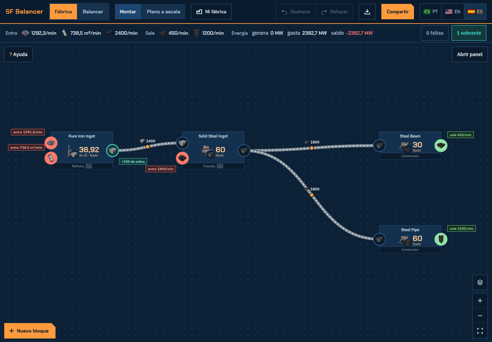

<div align="center">

# SF Balancer

**Planificador de fábricas y balanceador de cintas para [Satisfactory](https://www.satisfactorygame.com/)**

Arma la cadena como en tu planificador, mírala a escala y descubre cómo conectarla.

[**Abrir el planificador →**](https://sf-balancer.vercel.app/es)

[English](README.md) · [Português](README.pt-BR.md) · Español

[](https://sf-balancer.vercel.app/es)
[](LICENSE)




</div>

## El problema

Una etapa de la fábrica entrega **6 líneas de 455/min** (7 refinerías cada una). La siguiente necesita **5 líneas de 480/min** (12 fundiciones cada una). ¿Cómo se conectan? ¿Cuántas líneas se llenan, cuánto sobra y dónde va el balanceador?

Puedes hacer esa cuenta a mano cada vez, o escribir las máquinas y dejar que el planificador lo dibuje.

## El constructor de fábricas (página de inicio)

Al abrir el sitio llegas al constructor: arma la fábrica bloque a bloque, como en Satisfactory Modeler, solo que cada bloque ya conoce sus filas de máquinas.

- **Dos vistas, un botón arriba.** **Montar** (la principal) muestra cada bloque como una tarjeta: edificio, receta y número de máquinas, compacta como el nodo del Satisfactory Modeler, y puertos redondos con el color del estado, unidos por cintas animadas a un chip que dice qué necesita cada conexión (balanceador "6 → 5", directo, + Sink, tubería). **Plano a escala** muestra la misma fábrica en su tamaño real, en la cuadrícula de cimientos de 8 m. Nombres, puertos y chips se leen en cualquier zoom. Cada vista guarda sus propias posiciones: ordenar Montar no desarma el Plano (con "Mover juntos" activado, arrastrar vale para las dos). Al seleccionar un bloque, el panel muestra una miniatura de sus filas, con "Montar filas".
- **Arma con los gestos del Modeler.** Doble clic (o clic derecho) en un espacio vacío abre ahí mismo el selector: primero los recursos, un cuadradito por ítem como en el Modeler, después las recetas y las salidas (búsqueda, iconos, flechas + Enter). Arrastra desde el puerto de un bloque a un espacio vacío y el selector se abre filtrado en las recetas que consumen (o producen) ese ítem; el bloque nuevo nace conectado. Si lo sueltas en un puerto compatible, solo conecta. Supr borra, las flechas mueven 8 m, R gira, Ctrl+Z deshace. Shift o Ctrl + clic añade un bloque a la selección, Shift + arrastrar en un espacio vacío dibuja un rectángulo de selección y Ctrl+A (o "Seleccionar todo" en el panel) toma todo: arrastra uno para mover todos, Supr los borra todos en un solo paso de deshacer.
- **Números como en el Modeler, con el flujo físico.** El bloque nuevo consume lo que le llega; fija máquinas o la entrada cuando quieras. Lo que falta aparece en coral en el puerto ("faltan 120/min"), el excedente retenido en turquesa ("+330 de sobra"), la salida final de la fábrica en naranja, y el excedente liberado va a las otras ramas. La barra bajo la cabecera resume lo que entra, lo que sale (productos finales y lo que llega a los bloques Container y Salida) y lo que va al Awesome Sink, y los botones "N faltas" / "N sobrantes" llevan a cada problema en el mapa. Un subproducto sin salida atasca su bloque, como en el juego. Los bucles (goma y plástico reciclados) funcionan, y se señala el bucle atascado.
- **Orígenes y excedentes.** Miner (escribes cuánto sale), extractores de agua, petróleo y Resource Well (te dice cuántos hacen falta, con pureza donde el juego la tiene) y los bloques Awesome Sink, Container y Salida para recibir el excedente a propósito.
- **Arma las filas como en el juego.** Doble clic en un bloque (o "Montar filas" en el panel) abre la pantalla de la etapa: elige un modelo (**Fila simple**, **Espalda con espalda** o **Mergers en el medio**, con Invertir) y voltea, refleja o mueve cada fila en la cuadrícula de 8 m, corta la cinta cada N máquinas, haz que salga por la punta, por abajo o por arriba con un Conveyor Lift, o únela con la cinta de la fila de abajo. Los avisos (cinta sobre su capacidad, Merger con más de 3 entradas) traen el arreglo de un clic. El Plano a escala dibuja el mismo arreglo, con los lifts, y las conexiones reciben sus líneas. En un par espalda con espalda la cinta compartida cruza las dos filas cuando eso gasta menos salidas, y "Dividir igual" reparte las máquinas de una cinta lo más parejo posible en vez de llenar cada salida hasta el límite. La pantalla de la etapa tiene su propio desplazamiento y zoom y un resumen (tasa de cada salida, Splitters, Mergers, lifts, avisos); "← Volver al mapa" te devuelve.
- **Capas.** El botón Capas activa o desactiva en el mapa los íconos, los nombres, las conexiones (cintas y chips) y los puertos; "Solo las máquinas" oculta las cuatro.
- **Varias fábricas.** El botón "Fábricas" arriba lista las fábricas guardadas en este navegador: abrir, renombrar, duplicar, borrar o empezar una nueva. Selecciona algunos bloques y "Separar en nueva fábrica" los lleva a otra (lo que cruzaba el corte pasa a Entrada y Salida en las dos), útil para desarmar un archivo grande del Modeler. "Descargar copia" guarda todas en un `.json` y "Abrir copia" las trae a la lista en otro PC.
- **Energía y extractores al máximo.** El Biomass Burner y los generadores de carbón, combustible y nucleares queman su combustible (con agua y residuo donde el juego los tiene) y la barra de Balance suma los MW; en el plano a escala ocupan su tamaño real, en filas de cuantos alimenta una cinta o tubería; los extractores aceptan clock hasta 250 %, así un nodo puro de petróleo da 600/min como en el juego. Los recursos muestran el ítem con el edificio en la esquina, para que el Oil Extractor no se confunda con el Resource Well.
- **Copiar y pegar.** Ctrl+C copia los bloques seleccionados con las conexiones entre ellos, Ctrl+V los pega donde está el mouse (incluso en otra fábrica) y Ctrl+D duplica.
- **Entrada (container o tren).** Un origen de cualquier ítem que viene de fuera de la fábrica, con límite opcional; sin límite entrega lo que se pida y muestra cuánto. Es la primera de los recursos en el selector.
- **Importar del Modeler.** El botón "Importar del Modeler" lee un archivo `.sfmd` de Satisfactory Modeler aquí en el navegador (no se sube nada), muestra lo que encontró (bloques, conexiones, lo omitido o ajustado) y, solo cuando confirmas, la agrega como una fábrica nueva en tu lista. Los Splurgers y los Storage Containers de los que algo toma pasan a ser conexiones directas, y el Storage Container vacío pasa a ser una Entrada sin límite. El clock de las recetas viene incluido. El archivo trae el grafo y las recetas, no las tasas, así que los números se recalculan aquí; Montar conserva el dibujo del Modeler y la Planta a escala recibe la propuesta automática.
- **Conexiones.** Cada enlace entre bloques es una pieza del mapa: las cintas, Mergers, Splitters y el balanceador que necesita, a escala y arrastrable. Haz clic en su chip para un resumen corto con Ver montaje (el flujo animado, el paso a paso o abrirla en el Balancer), Cambiar montaje y Desconectar.
- **Un panel que explica.** Al seleccionar un bloque se abre el panel (una hoja inferior en el móvil) con el problema en una frase y arreglos de un clic (mandar el excedente al Awesome Sink, reducir las máquinas, aumentar la fuente, crear la fuente o el destino que falta); sin selección muestra el área de la fábrica, los avisos y las listas. El botón Leyenda explica los colores y los chips. En la primera visita, un tutorial breve señala cada parte de la pantalla (se puede saltar en cualquier momento; el botón Tutorial lo muestra de nuevo), y el "? Cómo usar" en el mapa, el panel y la pantalla de la etapa muestra solo los pasos de esa área.
- Se guarda en tu navegador y se comparte con un enlace. Los enlaces antiguos de `/planner` y las fábricas compartidas siguen abriendo.

Los iconos y datos vienen de los archivos del juego: © Coffee Stain Studios.

## El Balancer (`/es/balancer`)

La herramienta original, para una conexión escrita a mano: entran las tasas, salen cintas, splitters, mergers y balanceadores. Los enlaces antiguos de escenario (`#s=`) abren en ella.

- **Agrupa las máquinas en líneas de cinta.** Máquinas por línea = capacidad de la cinta ÷ tasa por máquina, redondeado hacia abajo. En el destino las máquinas se dividen en líneas iguales (14 que caben 8 por línea quedan en 7 + 7), y cada grupo tiene sus propias líneas. Editable, con aviso cuando la cinta se pasa.
- **Conecta las líneas.** Lista todos los montajes que encuentra, el mejor primero: directo, juntando líneas enteras, una línea donante dividida en partes iguales, o el overflow de un Smart Splitter pasando el exceso a una línea a la que le falta. Eliges qué pasa con el exceso: se retiene en el origen (las máquinas se frenan) o va al Awesome Sink, y entonces la recomendada llena todos los destinos sin retener nada, con un Smart Splitter a la salida de cada línea que sobra.
- **Diseña el balanceador.** El árbol exacto de splitters ("1 splitter en 2, luego 2 en 3 = 6 partes", con los 2 primero porque gasta menos piezas), si necesita loop, y la alternativa "dividir en más partes y mandar las sobrantes al sink", con diagrama.
- **Biblioteca de balanceadores.** Un generador N→M que prueba diez diseños (matriz, embudo y mariposa, cada uno también con loop o sink para 5, 7, 10…, y la matriz con loop dividido, que divide cada entrada en 2 antes del loop para que la cinta llena no se atasque: el 1→5 de 14 piezas y el 1→7 de 24 que usa la comunidad), revisa cada tramo interno contra el nivel de la cinta, explica por qué eligió uno y muestra el montaje paso a paso, con la pieza del paso resaltada como el holograma de la build gun. En el plan, el balanceador es un bloque que abres con un clic para ver ese montaje.
- **Normal, mariposa o 3D.** Elige el estilo de montaje: diseños planos, mariposa (cintas mezcladas de a pares en rondas, 16 piezas en 4→4 en vez de 20 y 48 en 8→8 en vez de 88; como mezcla carriles lejanos y es más difícil de montar, el planificador solo recomienda la mariposa cuando ahorra más del 20% de las piezas, abre su 3D en pisos; cualquier N→M de 2→2 a 9→9 y más, con carriles vacíos o carriles de más en loop, y 5→5 sale con 24 piezas) o una escena 3D que puedes girar y acercar, montada en torres (las piezas de cada capa apiladas, con las cintas cruzando entre las torres) o en pisos, con el conteo de lifts y el paso a paso como el holograma de la build gun: lo ya montado queda sólido, y el paso actual queda en un holograma transparente que pulsa, con luces que recorren las cintas en el sentido del flujo. Las cintas se conectan como en el juego, una por cara: el splitter recibe por atrás y saca por el frente y los lados, el merger al revés, y las flechas arriba de cada pieza muestran qué puertos están en uso. Pasa el mouse o toca una pieza para ver solo sus conexiones, o usa Seguir para iluminar todo el camino de una entrada o salida. En el paso a paso, Por pieza va de a un splitter o merger, con cada conexión explicada: por qué lado, de dónde viene y a dónde va. Normal y mariposa se dibujan vistos desde arriba, con las cintas en curva entrando y saliendo por el lado correcto de cada pieza, como en el juego (el splitter recibe por atrás y saca por el frente y los lados, el merger al revés, nunca dos cintas por el mismo lado), y el dibujo siempre cabe entero en la pantalla. Un selector Esquema / Planta lo muestra compacto o a escala: cuadrícula de cimientos de 8 m, piezas cuadradas que ocupan ¼ de cimiento (splitter naranja con en cuántas divide, merger verde azulado), cintas que salen y entran por los lados reales, y cuánto espacio ocupa (en cimientos y metros) y en qué Blueprint Designer cabe (Mk1 4×4, Mk2 5×5, Mk3 6×6). En la planta, marcadores del Blueprint Designer a escala, con el piso y la cuadrícula de cimientos del designer, ayudan a dividir un balanceador en blueprints: el designer más pequeño en el que cabe ya aparece cubriéndolo, añades cuantos marcadores Mk1, Mk2 o Mk3 quieras, y Ctrl + arrastrar (o Mover marcador en el celular) mueve uno, encajando en la cuadrícula. Por pieza funciona en los dos, con cada pieza numerada (#1, #2…); en la planta, la cinta mezclada lleva el color de la salida a la que va, y pasar el mouse o tocar una pieza muestra solo su camino.
- **Tus blueprints primero.** Anota los blueprints de balanceador que ya tienes (empieza con 3→4) y el planificador los prefiere cuando el formato coincide.
- **Atajos si no quieres montarlo.** Junto a cada balanceador, indica el mod [Modular Load Balancers](https://ficsit.app/mod/LoadBalancers) y los blueprints de la comunidad en [Satisfactory Calculator](https://satisfactory-calculator.com/es/blueprints).
- **Cuenta las piezas.** Mergers, splitters y Smart Splitters de cada tramo (recolección, medio, distribución), con la convención k o k−1 que prefieras.
- **Muestra el flujo.** Un diagrama animado donde los ítems avanzan a la velocidad del nivel de la cinta, como en el juego, y el grosor y la separación entre ítems siguen la tasa real. Cada pieza se dibuja como en el juego (splitter con hasta 3 salidas, cascada de mergers con hasta 3 entradas, retorno del loop, Smart Splitter, un Awesome Sink por cinta), con la tasa en cada cinta; el diagrama crece y se desplaza hacia el lado, y al hacer clic en un bloque se abre su detalle.
- **Avisa.** Cinta por encima de su capacidad, demanda mayor que la oferta, parte de la donante menor que el déficit, líneas incompletas.
- **También fluidos.** Cambia a "Fluido (tubería)" y usa Pipeline Mk1 (300) y Mk2 (600 m³/min). La tubería no tiene splitter, así que en lugar del balanceador junta y divide las tuberías con Pipeline Junctions en tuberías colectoras que respetan la capacidad, y cuando una tubería de origen tiene más de lo que necesita una colectora, una junction pasa el resto a la siguiente.
- **Deshacer y rehacer.** Ctrl+Z deshace y Ctrl+Y (o Ctrl+Shift+Z, Cmd en Mac) rehace cualquier cambio en las entradas, incluso escribiendo en un campo, y el resultado vuelve con ellos. Una escritura seguida es un solo paso; el historial dura mientras la página está abierta.
- **Guarda y comparte escenarios.** Guarda todos los escenarios que quieras en el navegador, con el nombre del ítem, y copia un enlace que lleva el escenario entero, para abrirlo en otro ordenador o mandárselo a un amigo.
- **Reporta un caso raro.** Un enlace al final del plan abre un issue en GitHub ya rellenado con el enlace del escenario y el montaje mostrado, y solo describes qué parece estar mal.
- **Se explica.** Cada campo y cada resultado tiene un `?` con una explicación corta, y al final de la página está la sección "Cómo funciona".
- **Tres idiomas:** English, Português (Brasil) y Español.

## Reglas del juego que respeta

| Pieza | Comportamiento |
| --- | --- |
| Cintas | Mk1 60, Mk2 120, Mk3 270, Mk4 480, Mk5 780, Mk6 1200 ítems/min (1.0). |
| Splitter | Hasta 3 salidas, divide en partes iguales. La división directa solo llega a productos de 2 y 3, así que 1/5 o 1/7 necesitan loop o partes extra al sink. |
| Merger | Hasta 3 entradas, por turnos. Una línea de complemento en serie por varios mergers deja sin ítems a los últimos, así que el planificador nunca lo sugiere. |
| Smart Splitter | La salida Overflow solo recibe ítems cuando la salida Any está llena. |
| Awesome Sink | Recibe cualquier sobrante de ítems. Retener en el origen también vale: las máquinas solo desaceleran. No acepta fluidos. |
| Tubería | Pipeline Mk1 300, Mk2 600 m³/min. Sin splitter: la Pipeline Junction (4 puertos) junta o divide y el fluido va adonde hay espacio, sin garantizar partes iguales. Para un caudal exacto, usa una Valve. |

El Balancer no conoce recetas: tú escribes las tasas de tu planificador o del juego. El constructor usa las recetas del juego.

## Ejecutarlo en local

Es un sitio estático construido con Vite (Node 22.18+).

```bash
git clone https://github.com/AdolfoCarneiro/sf-balancer.git
cd sf-balancer
npm install
npm run dev       # servidor local
npm run build     # build de producción en dist/
```

Tests (lógica, idiomas y el modelo del constructor), la comprobación de tipos del constructor y un smoke de punta a punta de sus gestos contra el preview:

```bash
npm test
npm run typecheck
npm run build && npm run preview   # luego, en otra terminal:
npm run smoke -- http://localhost:4173
```

Para probarlo como en producción (nginx sirviendo el build, con las rutas `/pt`, `/es`, `/balancer`, `/pt/balancer` y `/es/balancer`), ejecuta `docker compose up --build` y abre http://localhost:8080. Para limpiar: `docker compose down --rmi local`.

## Cómo está organizado el código

```
index.html            el constructor (React + TypeScript; HTML base en inglés, para los buscadores)
balancer.html         el Balancer (JavaScript puro)
src/planner/          constructor: model/ (puro: estado de la fábrica, solver del flujo, escena del mapa), worker/ (solver y conexiones fuera del hilo principal) y ui/
src/main.js           punto de entrada del Balancer
src/logic/            funciones puras, sin DOM (agrupamiento, clasificación de casos, árboles de splitters, simulación del flujo)
src/i18n/             textos en pt, en y es
src/ui/               interfaz
src/view3d/           escena 3D (three.js, se carga solo al abrir la pestaña 3D)
src/styles/main.css   estilos
public/               estáticos (favicon, og.png, robots.txt, sitemap.xml, iconos del juego en icons/)
tests/                tests de la lógica y la comparación visual
vercel.json           build, headers, CSP, rutas y redirecciones
scripts/              generadores de los datos y los iconos del juego (gamedata.mjs, icons.mjs; se ejecutan a mano, fuera del build)
Dockerfile, nginx.conf, docker-compose.yml   prueba local como en producción (nginx sirviendo dist/)
```

La lógica son funciones puras que los tests importan directamente en Node, sin navegador.

## Contribuir

Los issues y pull requests son bienvenidos. Unas pocas reglas mantienen el proyecto en orden:

1. **Respeta las capas.** El Balancer es JavaScript puro y el constructor es React + TypeScript, los dos construidos con Vite; `src/logic` y `src/planner/model` no tocan el DOM.
2. **Todo texto visible existe en los tres idiomas.** Los textos están en `src/i18n/` (`pt.js`, `en.js`, `es.js`) y se leen con `t('clave')`. Una clave nueva entra en los tres en el mismo cambio; el test `idiomas: as mesmas chaves...` falla si falta alguna.
3. **La lógica va en funciones puras con tests.** Un montaje o regla nueva lleva su caso en `tests/logic.test.js`.
4. **No inventes mecánicas del juego.** Si no sabes cómo se comporta una pieza, abre un issue primero.

`AGENTS.md` tiene la especificación completa (en portugués) y sirve de instrucciones para agentes de IA.

## Apoyo

Si la herramienta te ahorró algunas cuentas, puedes [invitarme un café en Ko-fi](https://ko-fi.com/dofal). Totalmente opcional: la herramienta sigue siendo gratis.

## Licencia

[MIT](LICENSE). Herramienta hecha por fans, sin relación con Coffee Stain Studios. Satisfactory es una marca registrada de Coffee Stain Studios; los iconos y datos del juego en el constructor son © Coffee Stain Studios.
