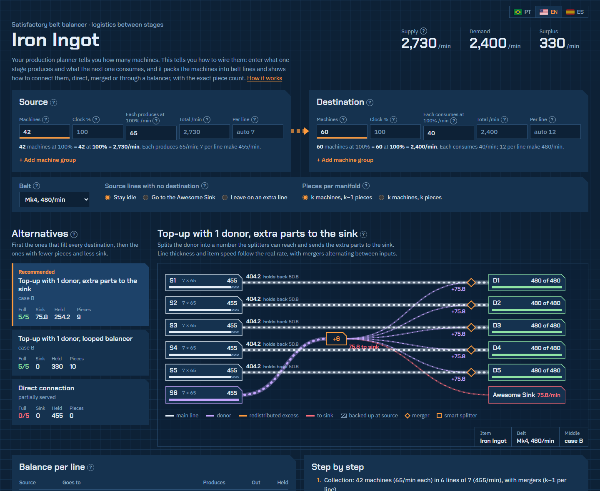

<div align="center">

# SF Balancer

**Belt balancer & logistics planner for [Satisfactory](https://www.satisfactorygame.com/)**

Your production planner tells you how many machines. This tells you how to wire them.

[**Open the planner →**](https://sf-balancer.vercel.app)

English · [Português](README.pt-BR.md) · [Español](README.es.md)

[](https://sf-balancer.vercel.app)
[](LICENSE)




</div>

## The problem

One stage of your factory makes **6 lines of 455/min** (7 refineries each). The next one needs **5 lines of 480/min** (12 foundries each). How do you connect them? How many lines fill up, how much is left over, and where does the balancer go?

You can do that math by hand every time, or you can type the machine counts and let the planner draw it.

## What it does

- **Groups machines into belt lines.** Machines per line = belt capacity ÷ rate per machine, rounded down. On the destination the machines are split into equal lines (14 that fit 8 per line become 7 + 7), and each group keeps its own lines. Editable, with a warning when you overload a belt.
- **Connects the lines.** Lists every layout it finds, best first: direct, merging whole lines, a donor line split into equal parts, or a Smart Splitter overflow passing excess to a line that's short. Choose what happens to the excess: back up at the source (machines slow down) or go to the Awesome Sink, in which case the recommended layout fills every destination with nothing backed up, using a Smart Splitter at the exit of each line with surplus.
- **Designs the load balancer.** Exact splitter tree ("1 splitter into 2, then 2 into 3 = 6 parts", 2s first because it takes fewer pieces), whether it needs a loop, and the "split into more parts and sink the extra" alternative, with a diagram.
- **Balancer library.** An N→M generator that tries ten designs (matrix, funnel and butterfly, each also with a loop or sink for 5, 7, 10…, plus a split looped matrix that divides each input in 2 before the loop, so a full belt doesn't bottleneck: the 14-piece 1→5 and 24-piece 1→7 the community uses), checks every internal segment against the belt tier, explains why it picked one, and shows the build step by step with the current piece highlighted like a build gun hologram. In the plan, the balancer is a block you click to open that build.
- **Normal, butterfly or 3D.** Pick the build style: flat designs, a butterfly (belts mixed in pairs over rounds, 16 pieces for 4→4 instead of 20 and 48 for 8→8 instead of 88; since it mixes lanes that are far apart and is harder to build, the planner only recommends a butterfly when it saves more than 20% of the pieces, opens its 3D view in floors; any N→M from 2→2 to 9→9 and beyond, with empty lanes or spare lanes on a loop, so 5→5 takes 24 pieces), or a 3D scene you can spin and zoom, built as towers (each layer's pieces stacked, belts crossing between towers) or floors, with the lift count and the step by step as a build gun hologram: what's built is solid, the current step is a pulsing see-through hologram, with lights running along the belts in the flow direction. Belts connect like in the game, one per face: a splitter takes input at the back and outputs at the front and sides, a merger the other way around, and the arrows on top of each piece show which ports are in use. Hover or tap a piece to see only its connections, or use Follow to light up the whole path of an input or output. Switch the step by step to By piece to go one splitter or merger at a time, with every connection spelled out: which side, where it comes from and where it goes. Normal and butterfly are drawn from above with curved belts that go in and out through the right side of each piece, like in the game (a splitter takes input at the back and outputs at the front and sides, a merger the other way around, never two belts on the same side), and the whole drawing always fits the screen. A Diagram / Plan switch shows it compact or to scale: an 8 m foundation grid, square pieces taking ¼ of a foundation (orange splitter with how many ways it splits, teal merger), belts leaving and entering through the real sides, and how much space it takes (in foundations and meters) and which Blueprint Designer it fits (Mk1 4×4, Mk2 5×5, Mk3 6×6). By piece works in both, with each piece numbered (#1, #2…); on the plan, a mixed belt takes the color of the output it goes to, and hovering or tapping a piece shows only its path.
- **Your blueprints first.** List the balancer blueprints you already have (it starts with 3→4) and the planner prefers them when the shape fits.
- **Shortcuts when you don't want to build it.** Next to each balancer it points to the [Modular Load Balancers](https://ficsit.app/mod/LoadBalancers) mod and to the community blueprints on [Satisfactory Calculator](https://satisfactory-calculator.com/en/blueprints).
- **Counts the pieces.** Mergers, splitters and Smart Splitters for each segment (collection, middle, distribution), with the k or k−1 convention you prefer.
- **Shows the flow.** An animated diagram where items move at the belt tier's speed, like in the game, and belt thickness and item spacing follow the real rate.
- **Warns you.** Belt over capacity, demand above supply, a donor part too small to cover the deficit, incomplete lines.
- **Fluids too.** Switch to "Fluid (pipe)" and it uses Pipeline Mk1 (300) and Mk2 (600 m³/min). Pipes have no splitter, so instead of a balancer it joins and divides pipes with Pipeline Junctions into header pipes that stay within capacity, and when a source pipe has more than one header needs, a junction passes the rest on to the next one.
- **Saves and shares scenarios.** Save as many scenarios as you want in your browser, named after the item, and copy a link that carries the whole scenario, to open on another computer or send to a friend.
- **Report an odd case.** A link at the bottom opens a GitHub issue already filled in with the scenario link and the layout shown, so you only describe what looks wrong.
- **Explains itself.** Every field and result has a `?` with a short explanation, and there's a "How it works" section at the bottom.
- **Three languages:** English, Português (Brasil) and Español.

## Game rules it follows

| Piece | Behavior |
| --- | --- |
| Belts | Mk1 60, Mk2 120, Mk3 270, Mk4 480, Mk5 780, Mk6 1,200 items/min (1.0). |
| Splitter | Up to 3 outputs, splits evenly. Direct splits only reach products of 2 and 3, so 1/5 or 1/7 need a loop or extra parts to the sink. |
| Merger | Up to 3 inputs, round-robin. A top-up line in series through several mergers starves the last ones, so the planner never suggests that. |
| Smart Splitter | The Overflow output only gets items when the Any output is full. |
| Awesome Sink | Takes any leftover item. Backing up at the source is fine too: the machines just slow down. It doesn't take fluids. |
| Pipes | Pipeline Mk1 300, Mk2 600 m³/min. No splitter: a Pipeline Junction (4 ports) joins or divides and the fluid goes wherever there's room, with no guarantee of equal parts. For an exact flow, use a Valve. |

The planner knows no recipes. You type the rates from your production planner or the game.

## Running it locally

There is nothing to build. It's one HTML file.

```bash
git clone https://github.com/AdolfoCarneiro/sf-balancer.git
cd sf-balancer
# open index.html in your browser, or serve the folder:
npx serve .
```

Tests (Node 18+, no dependencies):

```bash
node --test tests/logic.test.js
```

## How the code is organized

```
index.html            the whole app: styles, i18n, pure logic and UI
tests/logic.test.js   tests for the logic block, run against the real index.html
vercel.json           headers, CSP and /pt, /es routes
```

Inside `index.html`, the code between `// LOGIC-START` and `// LOGIC-END` is pure functions (grouping, case classification, splitter trees, flow simulation). The tests extract that block and run it in Node, so the UI never needs a browser to be tested.

## Contributing

Issues and pull requests are welcome. A few rules keep the project healthy:

1. **Keep it one file, no build.** No frameworks, no bundler. Opening `index.html` has to work.
2. **Every visible text exists in three languages.** Strings live in the `I18N` object (`pt`, `en`, `es`) and are read with `t('key')`. A new key goes into all three in the same change; the test `idiomas: as mesmas chaves...` fails otherwise.
3. **Logic goes in pure functions with tests.** Add a test case to `tests/logic.test.js` for any new layout or rule.
4. **Don't invent game mechanics.** If you're not sure how a piece behaves in the game, open an issue first.

`AGENTS.md` has the full spec (in Portuguese) and works as instructions for AI coding agents.

## Support

If the tool saved you some math, you can [buy me a coffee on Ko-fi](https://ko-fi.com/dofal). Totally optional: the tool stays free.

## License

[MIT](LICENSE). Fan-made tool, not affiliated with Coffee Stain Studios. Satisfactory is a trademark of Coffee Stain Studios.
