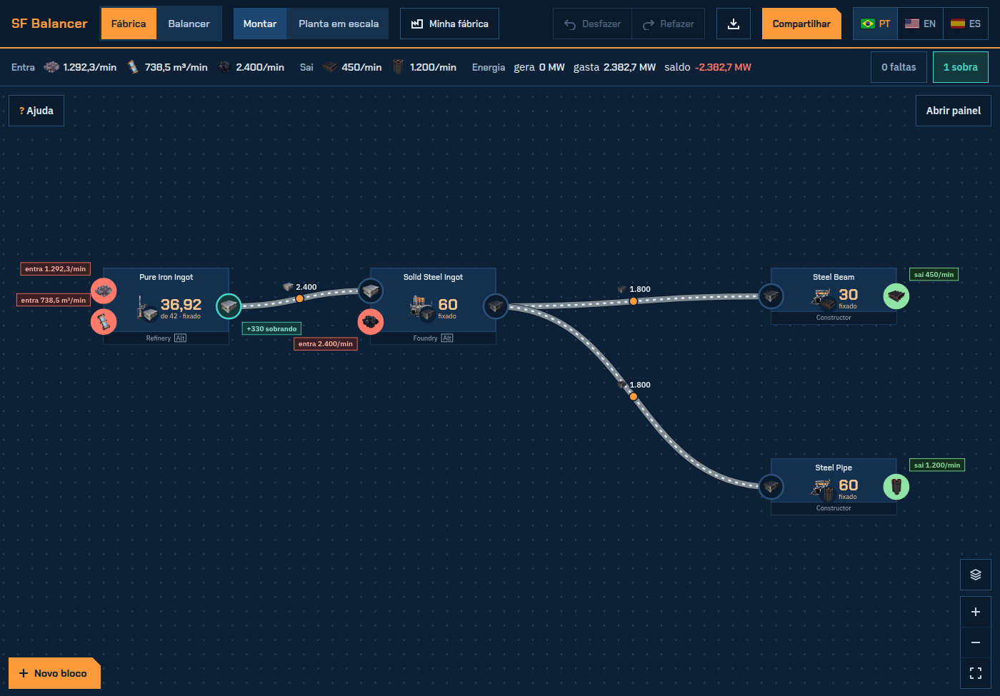

<div align="center">

# SF Balancer

**Balancer de esteiras e planejador de logística para [Satisfactory](https://www.satisfactorygame.com/)**

O seu planner diz quantas máquinas. Isto diz como ligar.

[**Abrir o planejador →**](https://sf-balancer.vercel.app/pt)

[English](README.md) · Português · [Español](README.es.md)

[](https://sf-balancer.vercel.app/pt)
[](LICENSE)




</div>

## O problema

Uma etapa da fábrica entrega **6 linhas de 455/min** (7 refinarias cada). A próxima precisa de **5 linhas de 480/min** (12 fundições cada). Como conectar? Quantas linhas fecham, quanto sobra e onde entra o balancer?

Dá para fazer essa conta na mão toda vez, ou digitar as máquinas e deixar o planejador desenhar.

## O que ele faz

- **Agrupa as máquinas em linhas de esteira.** Máquinas por linha = capacidade da esteira ÷ taxa por máquina, arredondado para baixo. Editável, com aviso quando a esteira estoura.
- **Liga as linhas.** Lista todas as montagens que encontra, a melhor primeiro: direto, juntando linhas inteiras, uma linha doadora dividida em partes iguais, ou o overflow de um Smart Splitter passando o excesso para uma linha que está com falta.
- **Monta o load balancer.** A árvore exata de splitters ("1 splitter em 3, depois 3 em 2 = 6 partes"), se precisa de loop, e a alternativa "dividir em mais partes e mandar as extras pro sink", com diagrama.
- **Biblioteca de balancers.** Um gerador N→M que testa nove designs (matriz, funil e borboleta, cada um também com loop ou sink para 5, 7, 10…), confere cada trecho interno contra o tier da esteira, explica por que escolheu um e mostra a montagem passo a passo, com a peça do passo destacada como o holograma da build gun. No plano, o balancer é um bloco que você clica para abrir essa montagem.
- **Normal, borboleta ou 3D.** Escolha o estilo de montagem: designs planos, borboleta (esteiras misturadas aos pares em rodadas, 16 peças no 4→4 em vez de 20 e 48 no 8→8 em vez de 88; qualquer N→M de 2→2 a 9→9 e além, com faixas vazias ou faixas a mais em loop, e o 5→5 sai com 24 peças) ou uma cena 3D que você gira e aproxima, montada em torres (as peças de cada camada empilhadas, com as esteiras cruzando entre as torres) ou em andares, com a contagem de lifts e o passo a passo como o holograma da build gun: o que já foi montado fica sólido, e o passo atual fica transparente, com as esteiras mostrando o sentido do fluxo.
- **Seus blueprints primeiro.** Liste os blueprints de balancer que você já tem (começa com 3→4) e o planejador prefere eles quando o formato bate.
- **Atalhos para quem não quer montar.** Junto de cada balancer, aponta o mod [Modular Load Balancers](https://ficsit.app/mod/LoadBalancers) e os blueprints da comunidade no [Satisfactory Calculator](https://satisfactory-calculator.com/pt/blueprints).
- **Conta as peças.** Mergers, splitters e Smart Splitters de cada trecho (coleta, meio, distribuição), na convenção k ou k−1 que você preferir.
- **Mostra o fluxo.** Um diagrama animado em que os itens andam na velocidade do tier da esteira, como no jogo, e a espessura e o espaço entre os itens seguem a taxa real.
- **Avisa.** Esteira acima da capacidade, demanda maior que a oferta, parte da doadora menor que o déficit, linhas incompletas.
- **Se explica.** Todo campo e resultado tem um `?` com uma explicação curta, e no fim da página tem a seção "Como funciona".
- **Três idiomas:** English, Português (Brasil) e Español.

## Regras do jogo que ele respeita

| Peça | Comportamento |
| --- | --- |
| Esteiras | Mk1 60, Mk2 120, Mk3 270, Mk4 480, Mk5 780, Mk6 1.200 itens/min (1.0). |
| Splitter | Até 3 saídas, divide igual. A divisão direta só chega em produtos de 2 e 3, então 1/5 ou 1/7 pedem loop ou partes extras pro sink. |
| Merger | Até 3 entradas, alternando entre elas. Uma linha de complemento em série por vários mergers deixa os últimos com fome, então o planejador nunca sugere isso. |
| Smart Splitter | A saída Overflow só recebe item quando a saída Any está cheia. |
| Awesome Sink | Recebe qualquer sobra. Represar na origem também serve: as máquinas só desaceleram. |

O planejador não conhece receitas. Você digita as taxas do seu planner ou do jogo.

## Rodando localmente

Não tem build. É um arquivo HTML só.

```bash
git clone https://github.com/AdolfoCarneiro/sf-balancer.git
cd sf-balancer
# abra o index.html no navegador, ou sirva a pasta:
npx serve .
```

Testes (Node 18+, sem dependências):

```bash
node --test tests/logic.test.js
```

## Como o código está organizado

```
index.html            o app inteiro: estilos, idiomas, lógica pura e interface
tests/logic.test.js   testes do bloco de lógica, rodando contra o index.html de verdade
vercel.json           headers, CSP e as rotas /pt e /es
```

Dentro do `index.html`, o código entre `// LOGIC-START` e `// LOGIC-END` é só função pura (agrupamento, classificação dos casos, árvores de splitter, simulação do fluxo). Os testes extraem esse bloco e rodam no Node, sem precisar de navegador.

## Contribuindo

Issues e pull requests são bem-vindos. Algumas regras mantêm o projeto em ordem:

1. **Um arquivo só, sem build.** Sem framework, sem bundler. Abrir o `index.html` tem que funcionar.
2. **Todo texto visível existe nos três idiomas.** Os textos ficam no objeto `I18N` (`pt`, `en`, `es`) e são lidos com `t('chave')`. Chave nova entra nos três na mesma mudança; o teste `idiomas: as mesmas chaves...` quebra se faltar.
3. **Lógica em função pura, com teste.** Montagem ou regra nova ganha um caso em `tests/logic.test.js`.
4. **Não invente mecânica do jogo.** Na dúvida sobre como uma peça se comporta, abra uma issue antes.

O `AGENTS.md` tem a especificação completa e serve de instrução para agentes de IA.

## Apoie

Se a ferramenta te poupou umas contas, você pode [me pagar um café no Ko-fi](https://ko-fi.com/dofal). Totalmente opcional: a ferramenta continua grátis.

## Licença

[MIT](LICENSE). Ferramenta feita por fã, sem vínculo com a Coffee Stain Studios. Satisfactory é marca registrada da Coffee Stain Studios.
